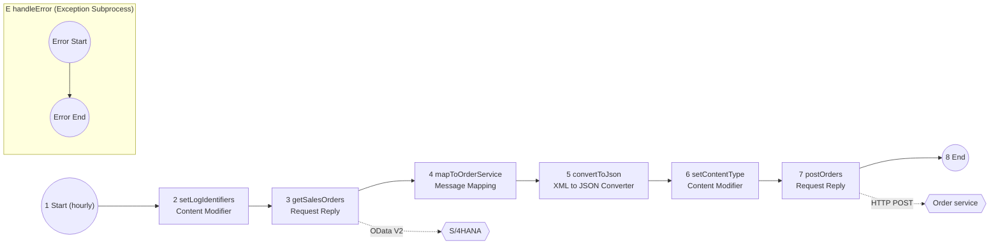
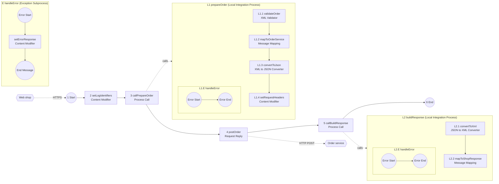

# Design: declare first, then build

When the user gives a goal ("receive orders from A, map them, send them to B") instead of exact steps, decide which components realize it and in which order, **declare that design, and wait for approval**. Nobody builds anything before that. The design follows SAP's integration flow design guidelines ([guidelines.md](guidelines.md)). It is the design the guidelines call for, not the design that is easiest to build: how the iFlow will be built (in the CPI designer, by another tool, by an AI) never changes it.

Related: [guidelines.md](guidelines.md) (what a good design must respect), [components.md](components.md) (which standard component fits a purpose).

## The design file

The declaration is written to one Markdown file in the user's project: `docs/<design name>.md`, where the design name is the iFlow name (B1 in [guidelines.md](guidelines.md)), or a name for the whole design when it spans several iFlows. Create `docs/` if it does not exist. If the file already exists, read it first: change it only when it holds this design; otherwise ask for another name.

The file is the only file this skill writes. It never writes `.iflw` XML, scripts or other iFlow files.

In the conversation, show the flow diagram, a short summary (what starts the iFlow, what it does, where it ends) and the file path. Do not paste the whole file into the conversation.

## Presenting, questions, approval

1. **Write the file and present it** as described above.
2. **Ask the questions of section 5 one at a time.** Put the questions of all iFlows into one list; ask first those that change the flow. Ask one question per message, and with each question give:
   - which iFlow and which rows it affects
   - the options, and the one you recommend with its reason
   If the client offers a way to ask the user a question with options, use it; otherwise ask in a normal message.
3. **After each answer**, update the file: mark the question as answered and change the sections the answer affects. Show the diagram again only when the flow changed. Then ask the next question. A new question that comes up from an answer goes to the end of the list.
4. **When no question is open**, ask for approval of the whole design, with the file path. A question or a correction is not approval: change the file, show the diagram again if the flow changed, and ask again.
5. **End your turn after every question and every request for approval.** Do not build anything, and do not write any file other than the design file, before the user approves.

If something must change after approval (a step cannot work as declared, a new step is needed), change the file, present the change, and wait for approval again.

## Declaration format

The design file is the contract between this skill and whoever builds the iFlow. The build skill **cpi-iflow-build** reads it, so keep the headings, their order and the flow table columns exactly as below. Change this format only together with cpi-iflow-build.

Write the text in the user's language; keep the headings' numbers, step names and component names in English.

````markdown
# <design name>

## Design: <iFlow name, see "Naming conventions" in guidelines.md (B1)>

### 0. Assumptions
- Trigger: <who or what starts the iFlow: sender system and adapter, or a timer>
- Volume: <messages per call or per run, size>
- Receiver: <system, protocol, what it accepts>
- Authentication: <inbound and outbound; credentials the user deploys in Security Material>
- Data: <formats; where the mapping rules come from>
Correct anything that is wrong before approving.

### 1. Flow
```mermaid
<flow diagram, see "Flow diagram" below>
```

| # | Step name | Component | Role |
|---|---|---|---|
| 1 | <role-based English name> | <component (+ adapter)> | <what it does> |
| … | | | |
| E | <name> | Exception Subprocess (<steps inside>) | <how errors end> |

#### Local Integration Process L1: <name>
| # | Step name | Component | Role |
|---|---|---|---|
| L1.1 | <role-based English name> | <component (+ adapter)> | <what it does> |
| … | | | |
| L1.E | <name> | Exception Subprocess (<steps inside>) | <how errors end> |

### 2. Why this shape
- <component choice> — <guideline it follows, with link>
- <for every Groovy Script: why no standard component does it>

### 3. Externalized
- Externalize: <value — reason (changes per landscape)>
- Keep fixed: <value — reason>

### 4. Build order
- <before building: credentials and other artifacts to deploy>
- <which part (or which iFlow) first, and the test call after each part>

### 5. Questions
- Q1 (rows <#>): <question> — Open
- Q2 (rows <#>): <question> — Answered: <the answer, and what it changed>
````

Rules for the flow table:

- One row per step in the order a message passes them. Adapters go in the row of the step they belong to (the sender adapter with the Start row, a receiver adapter with its Request Reply row). The Exception Subprocess is row `E` (inner steps `E1`, `E2`, … if they need their own rows).
- **Step name**: an English name that says what the step does. Never the designer's default (`Content Modifier 1`, `Request Reply 1`). SAP's naming conventions suggest a short camelCase description such as `setContentType` ([guidelines.md](guidelines.md), B1).
- **Component**: the component and the settings that decide its shape (method, authentication type, end event type), because a builder needs them to know what the row is.
- When the design changes an existing iFlow, list its existing steps too and end their Role with "(existing)".

Local Integration Processes (when to use them: [guidelines.md](guidelines.md), A7):

- The main table holds the main Integration Process only. A Process Call is one row there; its Component names the process it calls: `Process Call (→ L1 enrichOrders)`.
- Each Local Integration Process gets its own table under `#### Local Integration Process L<n>: <name>`, below the main table, numbered `L1`, `L2`, … in the order the main flow calls them. Its rows are `L1.1`, `L1.2`, …; its Exception Subprocess is `L1.E` (inner steps `L1.E1`, …).
- A Local Integration Process has no start or end row of its own unless its end type matters: write an `Error End` row when it passes an error on to the main process on purpose.
- Steps a Local Integration Process may not contain (another Local Integration Process, End Message, sender, receiver) never appear in its table ([guidelines.md](guidelines.md), A7).
- Count the main table's rows before writing the file. With more than 7 steps (start event, end events and row E not counted), move a group of steps into a Local Integration Process, or say in "2. Why this shape" why the flow stays in one process.

Rules for section 5:

- Number the questions `Q1`, `Q2`, … across the whole file (all iFlows), so that each can be asked and answered on its own.
- Each question ends with `Open` or `Answered: <answer>`. An approved design has no `Open` question.

## Flow diagram

The diagram shows the flow at a glance; the table holds what a builder needs. Both describe the same steps: when one changes, change the other.

Write it as a Mermaid `flowchart LR`:

- One node per table row. The node id is `s` plus the row number (`s3`, `sE1`); the label is the row number, the step name and the component without its settings, in double quotes: `s3["3 getSalesOrders<br/>Request Reply"]`.
- Start and end events as circles: `s1(("1 Start (hourly)"))`. A Router as a diamond, with each route's condition on its edge: `s4{"4 routeByType<br/>Router"} -->|"type = A"| s5`.
- Sender and receiver systems as their own nodes with the system name, `sys_s4{{"S/4HANA"}}`, joined to their step by a dotted edge with the adapter: `s3 -. "OData V2" .-> sys_s4`.
- The Exception Subprocess as `subgraph E ["E handleError (Exception Subprocess)"]` holding its inner steps, not joined to the main flow.
- A Local Integration Process as a subgraph too, `subgraph L1 ["L1 enrichOrders (Local Integration Process)"]`, with node ids `sL1_1`, `sL1_2`, … and its own Exception Subprocess as a nested subgraph. Join the Process Call step to the subgraph by a dotted edge: `s3 -. "calls" .-> L1`. Write the subgraphs after the main flow's edges (see "Example with Local Integration Processes").

When the design spans several iFlows, add an overview diagram right below the file title, before the first `## Design:` section: one node per iFlow, and one edge per Interface section, labelled with the adapter and address.

## Several iFlows

A design may span several iFlows (for example, to reuse a part or to call a common error handler). Write the overview diagram, sections 0–5 for each iFlow, plus one **Interface** section for each connection between them:

```markdown
### Interface: <caller> → <callee>
- Adapter: ProcessDirect, address `<address>`
- Request: Body <format and structure>; headers <names>; exchange properties <names, if the callee needs them>
- Response: Body <format>; headers <names>
- Errors: <how the callee ends on error (its Exception Subprocess end type) and how the caller handles it>
```

Build one iFlow at a time. Build the callee first, so the caller can be tested against it. Splitting work *inside* one iFlow is done with Local Integration Processes, not with more iFlows ([guidelines.md](guidelines.md), A7).

## Example

Goal from the user: "Every hour, read the sales orders from S/4HANA through OData, turn them into JSON, and POST them to our order service's REST API."

The file `docs/Global_SalesOrder_S4_to_OrderService.md`, as first written (before the questions are asked):

````markdown
# Global_SalesOrder_S4_to_OrderService

## Design: Global_SalesOrder_S4_to_OrderService

### 0. Assumptions
- Trigger: a timer, every hour. No system calls this iFlow.
- Source: S/4HANA OData V2 service API_SALES_ORDER_SRV, entity A_SalesOrder; credential deployed by you in Security Material.
- Volume: up to a few hundred orders per run, sent in one POST as a JSON array.
- Receiver: the order service accepts POST with a JSON array; OAuth2 Client Credentials, credential deployed by you.
- Mapping: you provide the field list (S/4HANA field → order service field). No value mapping.

### 1. Flow


| # | Step name | Component | Role |
|---|---|---|---|
| 1 | Start (hourly) | Timer start event | Starts a run every hour |
| 2 | setLogIdentifiers | Content Modifier | Sets SAP_Sender, SAP_Receiver, SAP_MessageType, SAP_ApplicationID for searching message logs |
| 3 | getSalesOrders | Request Reply + OData V2 receiver | Reads the sales orders from S/4HANA |
| 4 | mapToOrderService | Message Mapping | Maps the S/4HANA structure to the order service structure |
| 5 | convertToJson | XML to JSON Converter | Changes the format only |
| 6 | setContentType | Content Modifier | Sets Content-Type: application/json |
| 7 | postOrders | Request Reply + HTTP receiver (POST, OAuth2 Client Credentials) | Sends the orders |
| 8 | End | End event | |
| E | handleError | Exception Subprocess (Error Start → Error End) | Ends a failed run as Failed in monitoring |

### 2. Why this shape
- Reading S/4HANA: the OData adapter, the standard channel for OData services; no hand-built HTTP calls.
- Mapping: Message Mapping, SAP's recommendation for mapping to a new schema; Converter for a pure format change ("Guidelines for Modifying Content"). No Groovy Script: no step needs the script API.
- Error handling: an Exception Subprocess ("Handle Errors Gracefully"). Error End, not End Message, because no caller waits for a reply and a failed run must show as Failed.
- Identifiers for message monitoring ("Use Custom Header Properties to Search for Message Processing Logs"; tenant rule "Define Identifiers To Search In Message Processing Logs").
- One iFlow, no Local Integration Process: the flow is short and linear.

### 3. Externalized
- Externalize: S/4HANA address and credential name, order service address and credential name, timer schedule — they change per landscape.
- Keep fixed: entity and query options, header names, the mapping, the identifier values — they are part of the interface, not of the landscape.

### 4. Build order
- Before building: you deploy the S/4HANA and order service credentials in Security Material.
- First rows 2–7 with a manual start, and check the JSON that reaches the order service; then the timer (row 1) and row E.

### 5. Questions
- Q1 (rows 1–3): Full load or only orders changed since the last run? Delta needs the last run time stored between runs (more steps). — Open
- Q2 (rows 4–5): Does the order service have an OpenAPI spec? Then Message Mapping can produce JSON directly and row 5 is dropped. — Open
- Q3 (row E): On failure, is "Failed in monitoring" enough, or do you need a retry or an alert? — Open
- Q4 (row 2): Which value for SAP_ApplicationID? A run has many orders; I propose the run's start time. — Open
````

Then, in the conversation: the diagram, a two-line summary and the path, followed by the first question only:

```markdown
Q1 of 4 (Global_SalesOrder_S4_to_OrderService, rows 1–3): Full load every hour, or only the orders changed since the last run?
- Full load (recommended for a start): no state between runs; the order service must accept orders it already has.
- Delta: only changed orders; needs the last run time stored between runs, which adds steps before row 3.
```

### Example with Local Integration Processes

Goal from the user: "Our web shop POSTs an order (XML) to CPI. Validate it, map it to the order service's JSON, POST it there, and reply to the shop with the order number in the shop's XML format, or with an error message."

In one process the main flow would have 9 steps (validate, map, convert, set headers, post, convert back, map the response, …), more than 7 ([guidelines.md](guidelines.md), A7). Two groups have a purpose of their own: preparing the request and building the response. Section 1 of the file (the other sections as above):

````markdown
### 1. Flow


| # | Step name | Component | Role |
|---|---|---|---|
| 1 | Start | Start event + HTTPS sender | Receives the order from the web shop |
| 2 | setLogIdentifiers | Content Modifier | Sets SAP_Sender, SAP_Receiver, SAP_MessageType, SAP_ApplicationID (the shop's order ID) |
| 3 | callPrepareOrder | Process Call (→ L1 prepareOrder) | Turns the shop order into the order service request |
| 4 | postOrder | Request Reply + HTTP receiver (POST, OAuth2 Client Credentials) | Creates the order |
| 5 | callBuildResponse | Process Call (→ L2 buildResponse) | Turns the reply into the shop's response |
| 6 | End | End event | Replies to the web shop |
| E | handleError | Exception Subprocess (Error Start → setErrorResponse → End Message) | Replies to the web shop with an error message |

#### Local Integration Process L1: prepareOrder
| # | Step name | Component | Role |
|---|---|---|---|
| L1.1 | validateOrder | XML Validator | Rejects an order that does not match the shop's XSD |
| L1.2 | mapToOrderService | Message Mapping | Maps the shop order to the order service structure |
| L1.3 | convertToJson | XML to JSON Converter | Changes the format only |
| L1.4 | setRequestHeaders | Content Modifier | Sets Content-Type: application/json |
| L1.E | handleError | Exception Subprocess (Error Start → Error End) | Passes the error on to row E of the main process |

#### Local Integration Process L2: buildResponse
| # | Step name | Component | Role |
|---|---|---|---|
| L2.1 | convertToXml | JSON to XML Converter | Changes the format only |
| L2.2 | mapToShopResponse | Message Mapping | Maps the reply to the shop's response structure with the order number |
| L2.E | handleError | Exception Subprocess (Error Start → Error End) | Passes the error on to row E of the main process |
````

The call to the order service (row 4) stays in the main process because it is what the flow is for, and should be seen at a glance. A Request Reply inside a Local Integration Process may also call a receiver ([guidelines.md](guidelines.md), A7). The reply to the shop (End, End Message) is in the main process because a Local Integration Process cannot contain an End Message.
